<p align="center">
  <a href="https://ruth-mutua.github.io"></a>
</p>

<p align="center">
  <a href="https://ruth-mutua.github.io"></a>
  <a href="https://www.linkedin.com/in/ruth-mutua-19a66b1b8"></a>
  <a href="mailto:crnmndinda@gmail.com"></a>
</p>

```yaml
apiVersion: v1
kind: Engineer
metadata:
  name: ruth-mutua
  location: Nairobi, Kenya  # EAT, UTC+3
spec:
  role: platform & cloud engineer
  clouds: [aws, azure, gcp]
  focus:
    - kubernetes in production
    - infrastructure as code
    - cloud security & compliance
    - incident response & postmortems
  editors: [vim, vscode]
  status: Running  # ✈️ live to fly
```

### `$ ls ~/stack`

<p>
  
  
  
  
  
  
  
  
  
  
  
  
  
  
  
  
  
  
  
  
  
  
  
  
  
  
  
  
</p>

### `$ kubectl get capabilities`

<table>
<tr>
<td colspan="2" valign="top">

<br /><b>Kubernetes platforms</b>
<br /><sub>Clusters a team doesn't have to babysit: autoscaling that follows real load, capacity right-sized so you pay for what you use, and disaster recovery that has been drilled, not just diagrammed.<br /><code>outcome: uptime without the babysitting</code></sub>
</td>
</tr>
<tr>
<td width="50%" valign="top">

<br /><b>Infrastructure as code</b>
<br /><sub>Every environment rebuildable from code, reviewed instead of clicked, with no drift between staging and production.<br /><code>outcome: safe, repeatable releases</code></sub>
</td>
<td width="50%" valign="top">

<br /><b>Cloud security</b>
<br /><sub>No static keys to leak, secrets in a vault, networks that deny by default, controls ready for SOC 2 and ISO 27001.<br /><code>outcome: audit-ready by default</code></sub>
</td>
</tr>
<tr>
<td width="50%" valign="top">

<br /><b>Reliability & observability</b>
<br /><sub>Problems found before customers find them, fixed at the root cause, and written up so they don't happen twice.<br /><code>outcome: fewer pages, faster recovery</code></sub>
</td>
<td width="50%" valign="top">

<br /><b>AI infrastructure</b>
<br /><sub>Every model call tied to a customer, spend capped before it surprises anyone, and free to switch models without touching the apps.<br /><code>outcome: AI spend you can see and control</code></sub>
</td>
</tr>
</table>

### `$ tail -n 4 ~/writing.log`

- [A peer mesh runs itself, as long as your seed, network policy and autoscaler say it can](https://www.linkedin.com/pulse/peer-mesh-runs-itself-long-your-seed-network-policy-autoscaler-mutua-ndzcf/)
- [The cheapest insurance in your cluster is a component that does nothing](https://www.linkedin.com/pulse/cheapest-insurance-your-cluster-component-does-nothing-ruth-mutua-3nhgf/)
- [Would I know if it weren't working? The health check question that changed how I build](https://www.linkedin.com/pulse/would-i-know-werent-working-health-check-question-changed-ruth-mutua-vxmof/)
- [Building my first Android application](https://www.linkedin.com/pulse/building-my-first-android-application-ruth-mutua/)

### `$ git log --author=ruth --oneline open-source/`

- **[JarvisCore](https://github.com/Prescott-Data/jarviscore-framework)**: contributor & maintainer of an open-source runtime for distributed AI agents ([PyPI](https://pypi.org/project/jarviscore-framework/)). Release engineering, CLI tooling, security hardening and contributor docs.
- **[swim-p2p](https://pypi.org/project/swim-p2p/)**: contributor to a peer-to-peer membership and messaging library based on the SWIM protocol.

### `$ watch -n 86400 contributions`

<picture>
  <source media="(prefers-color-scheme: dark)" srcset="https://raw.githubusercontent.com/Ruth-mutua/Ruth-mutua/output/github-contribution-grid-snake-dark.svg" />
  <source media="(prefers-color-scheme: light)" srcset="https://raw.githubusercontent.com/Ruth-mutua/Ruth-mutua/output/github-contribution-grid-snake.svg" />
  
</picture>

### `$ cat /etc/ruth.conf`

```ini
[off_the_clock]
f1     = lights out and away we go
golf   = while (ball != hole) retry()
coffee = minReplicas: 2
```

<p align="center"><sub>✈️ live to fly · built with Kubernetes, Terraform and a lot of coffee</sub></p>
